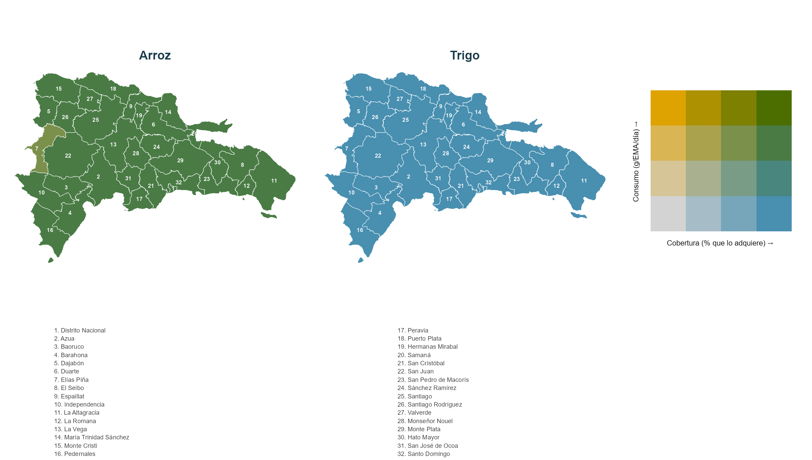

```{r}
#| label: setup-mapas-cobertura
#| include: false

source(here::here("reports", "_comun.R"))
library(dplyr)

exigir_archivo(file.path(RUTA_CLEAN, "vehiculos_por_provincia.csv"), "09_mapas.R")
for (m in c("mapa_bivariado_vehiculos.png")) {
  exigir_archivo(here::here("media", "mapas", m), "09_mapas.R")
}

veh_prov <- leer_limpio(file.path(RUTA_CLEAN, "vehiculos_por_provincia.csv")) |>
  left_join(
    leer_limpio(file.path(RUTA_CLEAN, "data_ema_hogar.csv")) |>
      distinct(id_provincia, des_provincia),
    by = "id_provincia")

resumen_veh <- veh_prov |>
  group_by(grupo) |>
  summarise(cob_min = min(pct_hogares), cob_max = max(pct_hogares),
            con_min = min(mediana),     con_max = max(mediana),
            .groups = "drop")

arroz <- resumen_veh |> filter(grupo == "Arroz")
trigo <- resumen_veh |> filter(grupo == "Trigo, en equivalentes de harina")

cob_baja_arroz <- veh_prov |> filter(grupo == "Arroz") |> slice_min(pct_hogares, n = 1)

# Nombre oficial de la provincia, de data/raw/provincias_nombres.csv, derivada
# de la misma fuente que la geometria. Los datos de la encuesta traen los
# nombres en mayusculas y sin acentos. El empate va por identificador: dos de
# las 32 provincias tienen denominacion distinta entre la encuesta y la fuente
# oficial, y unir por texto las perderia.
NOM_PROV <- leer_limpio(file.path(RUTA_RAW, "provincias_nombres.csv"))
cob_baja_arroz <- cob_baja_arroz |>
  left_join(NOM_PROV |> select(id_provincia, nombre_oficial), by = "id_provincia")
```

### Distribución territorial de la cobertura y el consumo de los vehículos

Un vehículo de fortificación sirve en la medida en que reúne dos condiciones a
la vez: que lo adquiera una proporción alta de hogares y que se consuma en
cantidad suficiente para transportar el fortificante. Las dos se examinan
juntas en la @fig-bivariado, con los mismos cortes fijos en ambos ejes y en los
dos vehículos, de modo que los mapas sean comparables entre sí.

::: {#fig-bivariado}

{fig-alt="Dos mapas de la República Dominicana por provincia, uno de arroz y otro de trigo en equivalentes de harina, coloreados simultáneamente por cobertura y consumo, con leyenda bivariada de cuatro por cuatro clases."}

Cobertura y consumo de los principales vehículos fortificables, por provincia.
El eje horizontal de la leyenda es la proporción de hogares que adquiere el
vehículo; el vertical, la mediana de consumo entre los hogares que lo
adquieren, en gramos por EMA y día. El trigo se expresa en equivalentes de
harina, que es la fracción sobre la que opera la norma. Cortes fijos en los dos
mapas. Fuente: Encuesta Nacional de Gastos e Ingresos de los Hogares 2018,
Banco Central de la República Dominicana; límites provinciales del geoportal
del IDERD y la División Territorial 2021 de la Oficina Nacional de Estadística.
La provincia no es dominio de estimación de la encuesta.

:::

La lectura principal es la ausencia de contraste territorial. La cobertura del
arroz va de `r fmt(arroz$cob_min, 1)`% a `r fmt(arroz$cob_max, 1)`% entre las 32
provincias, y la del trigo de `r fmt(trigo$cob_min, 1)`% a
`r fmt(trigo$cob_max, 1)`%. No existen zonas desatendidas: cualquiera de los dos
vehículos alcanza prácticamente a todo el país, y una norma de fortificación
aplicada a ellos no deja regiones fuera. El único apartamiento visible es el de
`r cob_baja_arroz$nombre_oficial`, con
`r fmt(cob_baja_arroz$pct_hogares, 1)`% de cobertura de arroz.

El contraste está en el otro eje, y es el que importa para la decisión. Los dos
vehículos comparten la clase de cobertura alta, pero no la de consumo: el arroz
se sitúa en la banda superior, con medianas provinciales de
`r fmt(arroz$con_min, 0)` a `r fmt(arroz$con_max, 0)` gramos por EMA y día,
mientras el trigo en equivalentes de harina ocupa la banda inferior, de
`r fmt(trigo$con_min, 0)` a `r fmt(trigo$con_max, 0)` gramos. La diferencia es
de naturaleza y no de hábito: el arroz se adquiere como grano y se consume
entero, mientras del pan, las pastas y las galletas solo una fracción es harina,
y es esa fracción la que transporta el fortificante.

De ahí que la cobertura por sí sola no ordene a los vehículos. **Alcanzar a
todos los hogares y entregar una cantidad apreciable del nutriente son
condiciones distintas, y en la ENGIH 2018 solo el arroz cumple las dos con
holgura.** Es la razón por la que los escenarios que incorporan el arroz
desplazan el riesgo de inadecuación mucho más que los que se limitan a la norma
vigente sobre la harina de trigo.
