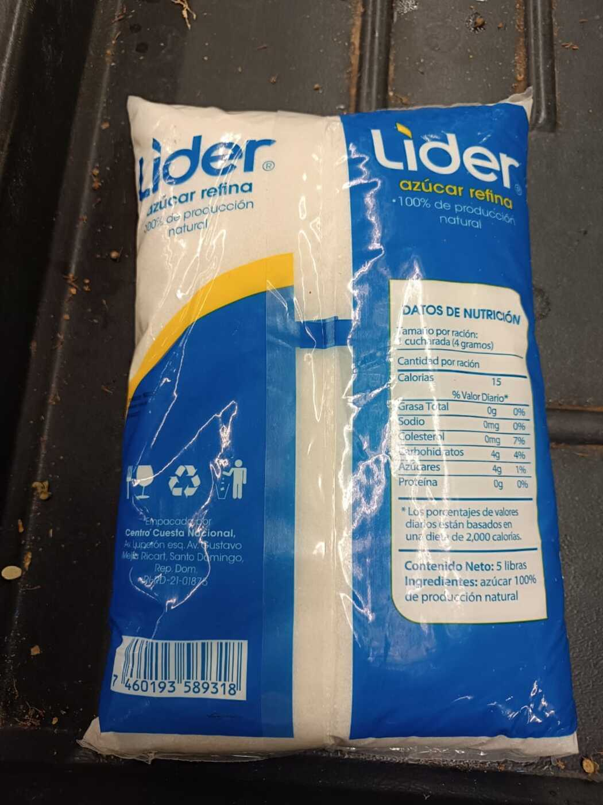
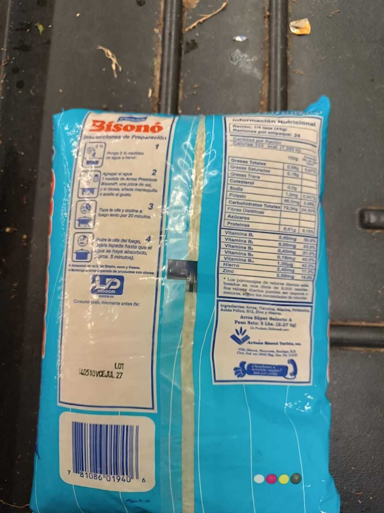
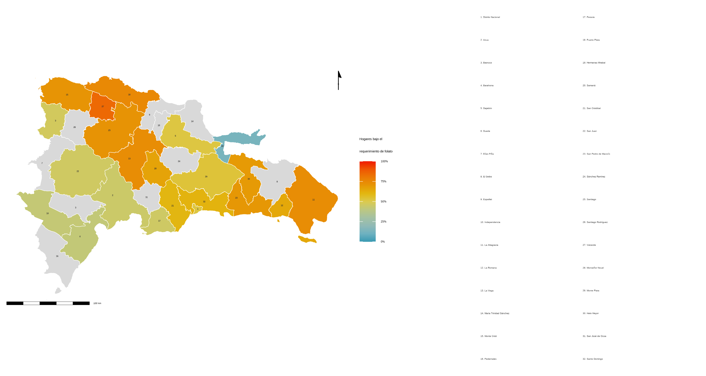
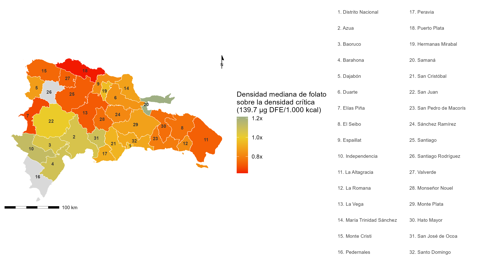
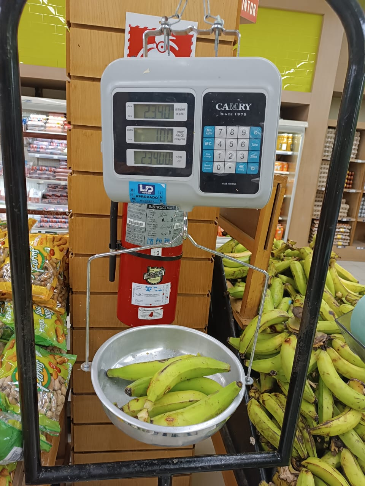

```{r}
#| label: setup
# Presentacion viva del proyecto. Se actualiza; no se duplica. Las versiones
# anteriores estan en la historia de git:
#   git log --oneline -- reports/presentacion_cierre.qmd
#   git show <hash>:reports/presentacion_cierre.qmd > version_anterior.qmd
ruta_comun <- c(here::here("reports", "_comun.R"),
                here::here("scripts", "_comun.R"))
source(ruta_comun[file.exists(ruta_comun)][1])
library(ggplot2); library(tidyr)

AZUL <- "#2c5364"; AZUL_C <- "#7ba3bd"; GRIS <- "#c9d3da"; ACENTO <- "#c0623c"

tema <- function(base = 16) {
  theme_minimal(base_size = base) +
    theme(panel.grid.minor   = element_blank(),
          panel.grid.major.x = element_blank(),
          panel.grid.major.y = element_line(colour = "#eef2f4"),
          axis.title  = element_text(colour = "#5a6b76", size = rel(0.85)),
          plot.title  = element_text(face = "bold", colour = "#1a3a4a",
                                     size = rel(0.95)),
          legend.position = "none")
}

leer_clean <- function(archivo, script) {
  f <- file.path(RUTA_CLEAN, archivo)
  exigir_archivo(f, script)
  leer_limpio(f)
}

rie   <- leer_clean("riesgo_inadecuacion.csv",   "07_riesgo_inadecuacion.R")
esc   <- leer_clean("escenarios_resumen.csv",    "06_escenarios_fortificacion.R")
gnut  <- leer_clean("grupos_micronutrientes.csv","08_grupos_alimentos.R")
sens  <- leer_clean("sensibilidad_densidad_critica.csv",
                    "diagnostico_densidad_critica.R")
acop  <- leer_clean("acoplamiento_energia.csv",  "diagnostico_densidad_critica.R")
proc  <- leer_clean("procedencia_por_provincia.csv", "diagnostico_procedencia.R")
veh   <- leer_clean("escenarios_consumo_vehiculos.csv", "06_escenarios_fortificacion.R")
gru   <- leer_clean("grupos_alimentos.csv", "08_grupos_alimentos.R")
refs  <- leer_limpio(file.path(RUTA_RAW, "valores_referencia.csv"))
auditoria <- leer_limpio(here::here("data", "auditoria",
                                    "verificacion_punto_venta_2026-10-04.csv"))
entregables <- leer_limpio(file.path(RUTA_RAW, "entregables_estado.csv")) |>
  arrange(orden)


# Escenarios citados en el texto. Si alguno cambia de nombre, la presentación
# se detiene en lugar de mostrar una cifra equivocada.
E_SIN   <- "0. Sin fortificación"
E_BASE  <- "1a. Norma nacional: harina y pan"
E_TODOS <- "1b. Norma nacional: harina y todos los derivados"
E_ARROZ <- "3. Norma nacional y arroz (propuesta nacional)"
faltan <- setdiff(c(E_SIN, E_BASE, E_TODOS, E_ARROZ), unique(esc$escenario))
if (length(faltan) > 0) {
  stop("Escenarios ausentes en escenarios_resumen.csv: ",
       paste(faltan, collapse = "; "), call. = FALSE)
}

ROTULOS <- tibble::tribble(
  ~escenario, ~corto,
  E_SIN,   "Sin\nfortificar",
  E_BASE,  "Norma:\nharina y pan",
  E_TODOS, "Norma: todos\nlos derivados",
  "1c. Norma nacional y azúcar",                         "Norma\n+ azúcar",
  "2a. OMS: harina y derivados, consumo menor de 75 g",  "OMS\n(<75 g)",
  "2b. OMS: harina y derivados, consumo de 75 a 149 g",  "OMS\n(75–149 g)",
  E_ARROZ, "Norma\n+ arroz"
)
sin_rotulo <- setdiff(unique(esc$escenario), ROTULOS$escenario)
if (length(sin_rotulo) > 0) {
  stop("Escenarios sin rótulo corto: ", paste(sin_rotulo, collapse = "; "),
       call. = FALSE)
}
corto <- function(x) ROTULOS$corto[match(x, ROTULOS$escenario)]
ORDEN_CORTO <- corto(c(E_SIN, sort(setdiff(unique(esc$escenario), E_SIN))))

# --- Extractores: una sola fila o error ---------------------------------------

# El hierro no se evalua por punto de corte sino por el enfoque de
# probabilidad. El metodo se resuelve por nutriente en lugar de fijarse: se
# excluye la variante de 18% de biodisponibilidad, de modo que queda una sola
# fila por nutriente, igual que en el informe.
metodo_de <- function(nutriente_) {
  m <- rie |>
    filter(nutriente == nutriente_, metodo != "Probabilidad, biodisponibilidad 18%") |>
    distinct(metodo) |> pull()
  if (length(m) != 1) {
    stop("Metodo no identificado para ", nutriente_, " (", length(m), ").",
         call. = FALSE)
  }
  m
}

riesgo_nac <- function(escenario_, nutriente_, metodo_ = metodo_de(nutriente_)) {
  v <- rie |>
    filter(dominio == "Nacional", hogares == "Todos", escenario == escenario_,
           nutriente == nutriente_, metodo == metodo_) |>
    pull(pct_inadecuado)
  if (length(v) != 1) {
    stop("Riesgo no identificado para ", escenario_, " / ", nutriente_,
         " / ", metodo_, " (", length(v), " filas).", call. = FALSE)
  }
  v
}

razon_esc <- function(escenario_) {
  v <- esc |> filter(escenario == escenario_) |> distinct(razon_q5_q1) |> pull()
  if (length(v) != 1) stop("Razón Q5/Q1 no identificada para ", escenario_, ".",
                           call. = FALSE)
  v
}

consumo_veh <- function(grupo_, columna) {
  v <- veh |> filter(grupo == grupo_) |> pull({{ columna }})
  if (length(v) != 1) stop("Vehículo no identificado: ", grupo_, ".", call. = FALSE)
  v
}

KCAL_EMA <- 2291
ESCENARIO_BASE <- "1a. Norma nacional: harina y pan"
NOMBRE <- c(folato_mcg_dfe = "Folato", hierro_mg = "Hierro", zinc_mg = "Zinc",
            vitamina_a_mcg_rae = "Vitamina A", vitamina_b12_mcg = "Vitamina B12",
            vitamina_d_mcg = "Vitamina D", vitamina_e_mg = "Vitamina E")

fol_prov <- sens |> filter(dominio == "Provincia", nutriente == "folato_mcg_dfe")
fol_nac  <- sens |> filter(dominio == "Nacional",  nutriente == "folato_mcg_dfe")
e_nac    <- median(sens$energia[sens$dominio == "Nacional"])
quint    <- sens |> filter(dominio == "Quintil", nutriente == "folato_mcg_dfe") |>
  arrange(nivel)
prov_alta <- fol_prov |> slice_max(energia, n = 1)
dc_fol <- refs |> filter(nutriente == "folato_mcg_dfe") |>
  mutate(dc = 1000 * ear / KCAL_EMA) |> pull(dc)
```
## Estado de los productos y fechas de entrega

```{r}
#| label: tbl-entregables
#| tbl-cap: "Situación de los productos comprometidos en los términos de referencia y fecha de entrega. Consultoría ENGIH 2018"

entregables |>
  transmute(
    Producto = entregable,
    `TdR`    = tdr,
    Situación = situacion,
    Entrega  = if_else(is.na(fecha_compromiso), "—",
                       format(as.Date(fecha_compromiso), "%d de octubre"))
  ) |>
  tabla(fuente = "Fuente: registro de avance del repositorio del proyecto.",
        notas = "Cierre de la consultoría: 23 de octubre de 2026.")
```

::: {style="font-size:0.82em; margin-top:0.35em;"}
La plataforma de capacitación está publicada y es accesible:
[**fortificacion.netlify.app**](https://fortificacion.netlify.app/) — 24 módulos,
17 ejercicios con autoevaluación y el taller completo.
:::

## Avance del período {.smaller}

- **Informe analítico final**: de esqueleto a borrador completo, con ocho figuras. Compila en HTML y Word.
- **Manual técnico**: diecisiete capítulos, con la tabla de supuestos y las hipótesis descartadas.
- **Mapas provinciales**: bivariado de cobertura y consumo, y coropléticos de riesgo y de densidad, con proyección e identificación de provincia.
- **Análisis por grupos de alimentos** extendido a cada micronutriente. Completa el TdR 8.4.

Y tres hallazgos que no estaban la semana pasada, que son el objeto de esta sesión.

::: {.notes}
Abrir por el avance, breve, y pasar enseguida a los hallazgos, que es donde está la discusión. El informe y el manual están para enseñarlos si preguntan.
:::

# Hallazgos {background-color="#2c5364"}

## Contribución de la norma vigente a la reducción del riesgo {.smaller}

```{r}
#| label: fig-norma-evita
#| fig-cap: "Hogares bajo el requerimiento sin fortificación y con la norma vigente de harina de trigo, según nutriente. República Dominicana, 2018"
#| fig-width: 10
#| fig-height: 3.6
NUT5 <- c("folato_mcg_dfe", "hierro_mg", "zinc_mg", "vitamina_b12_mcg",
          "vitamina_a_mcg_rae")
S_SIN <- "Sin fortificación"
S_NOR <- "Norma vigente: harina y pan"

cmp <- tibble::tibble(
  nutriente = NUT5,
  sin  = vapply(NUT5, function(n) riesgo_nac(E_SIN,  n), numeric(1)),
  base = vapply(NUT5, function(n) riesgo_nac(E_BASE, n), numeric(1))) |>
  mutate(Nutriente = NOMBRE[nutriente], reduccion = sin - base)

largo_cmp <- cmp |>
  tidyr::pivot_longer(c(sin, base), names_to = "esc", values_to = "pct") |>
  mutate(Escenario = factor(if_else(esc == "sin", S_SIN, S_NOR),
                            levels = c(S_SIN, S_NOR)))

ggplot(largo_cmp, aes(x = reorder(Nutriente, reduccion))) +
  geom_line(aes(y = pct, group = Nutriente), colour = GRIS, linewidth = 1.4) +
  geom_point(aes(y = pct, colour = Escenario), size = 4) +
  geom_text(data = cmp,
            aes(x = reorder(Nutriente, reduccion), y = (sin + base) / 2,
                label = if_else(reduccion >= 1,
                                paste0("−", fmt(reduccion, 1), " pp"), "")),
            vjust = -1, size = 4, colour = "#5a6b76", inherit.aes = FALSE) +
  scale_colour_manual(values = setNames(c(ACENTO, AZUL), c(S_SIN, S_NOR))) +
  coord_flip() +
  labs(x = NULL, y = "Hogares bajo el requerimiento (% del total de hogares)",
       colour = NULL) +
  tema() + theme(legend.position = "top")
```

::: {style="font-size:0.88em;"}
La fortificación de la harina de trigo reduce la proporción de hogares bajo el
requerimiento de folato en **`r fmt(cmp$reduccion[cmp$nutriente == "folato_mcg_dfe"], 1)` puntos porcentuales**
y la de hierro en **`r fmt(cmp$reduccion[cmp$nutriente == "hierro_mg"], 1)`**.
Los nutrientes que la norma no añade no se modifican.
:::

::: {.notes}
Abrir por aquí y no por el avance de la semana. Esta lámina responde una pregunta que nadie suele tener contestada: cuánto aporta lo que ya existe. Sirve para discutir presupuesto de fiscalización.
:::

## Escenarios de fortificación modelados

```{r}
#| label: tbl-escenarios-def
#| tbl-cap: "Escenarios de fortificación modelados: vehículos incluidos y nutrientes añadidos en cada uno. Consultoría ENGIH 2018"

VEH_TRIGO <- c("Harina de trigo", "Pan", "Pastas", "Galletas saladas",
               "Galletas dulces", "Repostería")
NUT_CORTO <- c(hierro_mg = "hierro", folato_mcg_dfe = "folato",
               zinc_mg = "zinc", vitamina_a_mcg_rae = "vitamina A",
               vitamina_b12_mcg = "vitamina B12")

resumir_veh <- function(v) {
  v     <- unique(v)
  trigo <- intersect(v, VEH_TRIGO)
  otros <- setdiff(v, VEH_TRIGO)
  etq <- if (length(trigo) >= 3) "harina de trigo y derivados"
         else if (length(trigo) > 0) tolower(paste(trigo, collapse = " y "))
         else character(0)
  paste(c(etq, tolower(otros)), collapse = ", ")
}

definicion <- leer_limpio(file.path(RUTA_RAW, "escenarios_fortificacion.csv"))
sin_etiqueta <- setdiff(unique(definicion$nutriente), names(NUT_CORTO))
if (length(sin_etiqueta) > 0) {
  stop("Nutrientes sin etiqueta corta: ", paste(sin_etiqueta, collapse = ", "),
       call. = FALSE)
}

resumen_esc <- definicion |>
  group_by(escenario) |>
  summarise(`Vehículos fortificados` = resumir_veh(vehiculo),
            `Nutrientes añadidos` = paste(unique(NUT_CORTO[nutriente]), collapse = ", "),
            .groups = "drop") |>
  arrange(escenario)

linea_base <- tibble::tibble(escenario = E_SIN,
                             `Vehículos fortificados` = "ninguno",
                             `Nutrientes añadidos` = "—")

bind_rows(linea_base, resumen_esc) |>
  rename(Escenario = escenario) |>
  tabla(fuente = "Fuente: parámetros normativos del repositorio del proyecto.",
        notas = paste("Cada escenario parte de la composición del alimento sin",
                      "fortificar y añade el nivel normativo en miligramos por",
                      "kilogramo de vehículo. Los resultados que siguen",
                      "presentan tres de estos escenarios; el informe recoge",
                      "los siete."))
```


## Escenarios según la acción institucional que requieren {.smaller}

| Escenario | Qué acción institucional exige |
|---|---|
| `1a` Norma nacional: harina y pan | **Situación observada en 2018.** Ninguna |
| `1c` Norma nacional y azúcar | **Hacer cumplir una norma vigente desde 2004.** No requiere legislar |
| `1b` Norma nacional: todos los derivados del trigo | Ampliar el alcance de una norma vigente |
| `2a` `2b` Niveles de la OMS | Revisar el nivel normativo sobre el mismo vehículo |
| `3` Norma nacional y arroz | Norma nueva, con precedente voluntario ya en el mercado |

: Escenarios modelados según la acción institucional que requieren. República Dominicana, 2018 {#tbl-escalera}

El azúcar no es «un escenario más»: es el único que **no exige crear nada**. La norma existe desde 2004 y el producto en venta no la cumple.

::: {.notes}
Esta es la lámina que convierte la modelación en una herramienta de decisión. Si solo se recuerda una, que sea esta.
:::

## Verificación en punto de venta

::: {.columns}
::: {.column width="26%"}

:::
::: {.column width="26%"}

:::
::: {.column width="48%"}
::: {style="font-size:0.86em;"}
**`r sum(auditoria$tipo == "etiqueta")` etiquetas** registradas con fotografía y
**`r sum(auditoria$tipo == "pesaje")` alimentos** pesados, para contrastar la
norma escrita con el producto disponible.

<br>

**El azúcar no declara vitamina A.** El escenario de azúcar modela una norma
cuya aplicación no se verificó en el producto.

<br>

**El arroz se comercializa fortificado** con siete nutrientes, por encima de
toda norma vigente. Ese escenario no es hipotético.
:::
:::
:::

::: {.notapie}
**NOTA:** Un establecimiento, un día; no constituye una muestra representativa del mercado. El detalle del pesaje está en el anexo.
:::

## Aporte de cada grupo de alimentos a cada micronutriente

```{r}
#| label: fig-grupos
#| fig-width: 11
#| fig-height: 5
largo <- gnut |>
  pivot_longer(all_of(names(NOMBRE)), names_to = "n", values_to = "pct") |>
  mutate(Grupo = sub("^[0-9]{2} ", "", grupo_mddw),
         Nutriente = factor(NOMBRE[n], levels = NOMBRE))
orden <- largo |> filter(n == "folato_mcg_dfe") |> arrange(pct) |> pull(Grupo)

largo |> mutate(Grupo = factor(Grupo, levels = orden)) |>
  ggplot(aes(Nutriente, Grupo, fill = pct)) +
  geom_tile(colour = "white", linewidth = 0.6) +
  geom_text(aes(label = if_else(pct >= 8, sprintf("%.0f", pct), "")),
            colour = "white", fontface = "bold", size = 4) +
  scale_fill_gradientn(colours = c("#eef2f4", AZUL_C, AZUL), limits = c(0, 100)) +
  labs(x = NULL, y = NULL) +
  labs(fill = "Aporte al nutriente (%)") +
  theme_minimal(base_size = 15) +
  theme(panel.grid = element_blank(), legend.position = "bottom",
        legend.key.width = unit(2.2, "cm"),
        axis.text.x = element_text(angle = 25, hjust = 1))
```

::: {.notes}
El número es el porcentaje del total del nutriente que aporta ese grupo. La lectura es por columna.
:::

## Implicación para la selección del vehículo

**Un escenario que fortifica un cereal no puede mover un nutriente que el cereal no aporta**, por alto que sea el nivel de adición.

La restricción es estructural y precede a cualquier discusión sobre dosis.

Para un oficial de nutrición se traduce en una frase operativa: fortificar harina no resolverá los nutrientes de origen animal, y proponerlo gasta capital político sin resultado posible.

::: {.notes}
Aquí es donde la figura anterior deja de ser descriptiva y pasa a ser una restricción de diseño de política.
:::

## Distribución territorial de la cobertura y el consumo


::: {style="font-size:0.88em;"}
Ambos vehículos presentan cobertura alta en las 32 provincias, sin zonas desatendidas. Difieren en el eje de consumo: el arroz se sitúa en la banda superior y el trigo en equivalentes de harina en la inferior, por la fracción de harina que contienen sus derivados.
:::

::: {.notes}
Hallazgo negativo que ahorra dinero: no hace falta focalizar geográficamente el vehículo. Decirle a alguien dónde no gastar es un servicio.
:::

## Hallazgo 3 · Distribución social del beneficio

::: {style="font-size:0.9em; margin-bottom:-0.2em;"}
**Razón de ingesta de folato entre los quintiles extremos de gasto:
`r fmt(razon_esc(E_BASE), 2)` con la norma vigente, `r fmt(razon_esc(E_ARROZ), 2)`
al incorporar el arroz.** El arroz se consume de forma transversal; los
derivados del trigo, no.
:::

```{r}
#| label: fig-equidad
#| fig-cap: "Ingesta aparente mediana de folato por Equivalente de Mujer Adulta y día en los quintiles extremos de gasto del hogar, según escenario de fortificación. República Dominicana, 2018"
#| fig-width: 10.5
#| fig-height: 3.2

eq <- esc |>
  distinct(escenario, folato_q1, folato_q5, razon_q5_q1) |>
  mutate(etq = factor(corto(escenario), levels = rev(ORDEN_CORTO)))

ggplot(eq, aes(y = etq)) +
  geom_segment(aes(x = folato_q1, xend = folato_q5, yend = etq),
               colour = GRIS, linewidth = 1.6) +
  geom_point(aes(x = folato_q1), colour = AZUL, size = 3.6) +
  geom_point(aes(x = folato_q5), colour = ACENTO, size = 3.6) +
  geom_text(aes(x = folato_q5, label = paste0("  razón ", fmt(razon_q5_q1, 2))),
            hjust = 0, size = 3.7, colour = "#44555f") +
  scale_x_continuous(expand = expansion(mult = c(0.04, 0.26))) +
  labs(x = "Folato (µg DFE por Equivalente de Mujer Adulta y día)", y = NULL) +
  tema(14) +
  theme(axis.text.y = element_text(lineheight = 0.95))
```

::: {.notapie}
**NOTA:** Punto azul: quintil de menor gasto. Punto anaranjado: quintil de mayor gasto. Un valor de la razón próximo a 1 indica que el vehículo alcanza por igual a ambos extremos.
:::

::: {.notes}
Nota metodológica completa. La razón es el cociente entre las medianas de los
quintiles extremos. El quintil es el definido por la propia encuesta.
Estimaciones ponderadas con el diseño muestral complejo: 8 estratos, 933
unidades primarias de muestreo y factor de expansión por hogar. DFE:
equivalentes dietéticos de folato. EMA: Equivalente de Mujer Adulta.
:::

## Implicación para el diseño de la intervención

La @fig-equidad lo muestra en una sola imagen: subir el nivel normativo sobre un vehículo de **consumo desigual** mejora el promedio y **conserva** el gradiente social.

Cambiar a un vehículo de **consumo transversal** cierra el gradiente.

Las dos decisiones son defendibles. **No son intercambiables**, y conviene tomarlas sabiendo que son dos y no una.

::: {.notes}
Esta es la conjetura que se formuló antes de ver los datos, y quedó respaldada. Está enunciada como pregunta 7 en el informe, no como apartado de hipótesis, por formato IMRyD.
:::

## Salvedad sobre las comparaciones entre provincias

La proporción de hogares bajo el requerimiento, estimada por provincia, sigue al
**nivel de adquisición registrada** y no a diferencias en la dieta. La provincia
tampoco es dominio de estimación de la encuesta.

Se examinaron siete mecanismos alternativos y ninguno explica el patrón. El
desarrollo está en el anexo.

**Estos datos no sostienen una afirmación de estado nutricional provincial.**

::: {.notes}
Una frase y seguir. Si preguntan por el detalle, el anexo tiene la secuencia completa: los siete mecanismos, el contraste por nivel de analisis y la hipotesis que queda abierta.
:::

## Opciones de intervención, acción requerida y rendimiento {.smaller}

```{r}
#| label: tbl-intervenciones
base_fol <- riesgo_nac(E_BASE, "folato_mcg_dfe")
opciones <- tibble::tribble(
  ~Intervención, ~escenario, ~`Acción institucional`,
  "Hacer cumplir la norma del azúcar", "1c. Norma nacional y azúcar",
    "Fiscalización. La norma existe desde 2004",
  "Ampliar la norma a todos los derivados del trigo", E_TODOS,
    "Ampliar alcance de una norma vigente",
  "Elevar al nivel recomendado por la OMS",
    "2b. OMS: harina y derivados, consumo de 75 a 149 g",
    "Revisar el nivel normativo",
  "Incorporar el arroz", E_ARROZ,
    "Norma nueva. Ya se comercializa fortificado")

opciones |>
  mutate(fol = vapply(escenario, function(e) riesgo_nac(e, "folato_mcg_dfe"),
                      numeric(1)),
         `Folato inadecuado (%)` = fmt(fol, 1),
         `Cambio frente a hoy` = paste0(if_else(fol < base_fol, "−", "+"),
                                        fmt(abs(fol - base_fol), 1), " pp")) |>
  select(Intervención, `Acción institucional`, `Folato inadecuado (%)`,
         `Cambio frente a hoy`) |>
  tabla(fuente = "Fuente: ENGIH 2018, Banco Central de la República Dominicana.",
        notas = paste0("Situación de referencia: norma vigente de harina de ",
                       "trigo aplicada a harina y pan, con ", fmt(base_fol, 1),
                       "% de hogares bajo el requerimiento de folato. ",
                       "Valores de referencia provisionales."))
```

La única que **no exige crear nada** es la primera.

::: {.notes}
Si solo se recuerda una lamina de toda la presentacion, que sea esta. Convierte el analisis en una carta de opciones con su costo institucional y su rendimiento.
:::

## Cuestiones sometidas a discusión

1. Valores de referencia: ¿ambos como sensibilidad?
2. Biodisponibilidad del hierro: ¿derivarla de la composición de la dieta?
3. El residuo geográfico: ¿se persigue la hipótesis de los factores de conversión?
4. Procedencia y destino: ¿se incorporan o se declaran como supuesto?


# Anexo {background-color="#4a7c9b"}

# 1 · La elección del vehículo determina qué nutrientes se pueden corregir

# 2 · Elevar la media y cerrar la brecha son dos decisiones

## Ingesta de hierro y folato en los siete escenarios

```{r}
#| label: fig-escenarios
#| fig-cap: "Ingesta aparente mediana de hierro y folato por Equivalente de Mujer Adulta y día, según escenario de fortificación. República Dominicana, 2018"
#| fig-width: 11
#| fig-height: 3.6

esc |>
  filter(nutriente %in% c("hierro_mg", "folato_mcg_dfe")) |>
  mutate(escenario = factor(corto(escenario), levels = ORDEN_CORTO),
         nutriente = factor(nutriente, c("hierro_mg", "folato_mcg_dfe"))) |>
  ggplot(aes(escenario, mediana)) +
  geom_col(fill = AZUL_C, width = 0.55) +
  geom_text(aes(label = fmt(mediana, 0)), vjust = -0.4, size = 3.7,
            colour = "#44555f") +
  scale_y_continuous(expand = expansion(mult = c(0, 0.22))) +
  facet_wrap(~nutriente, scales = "free_y",
             labeller = as_labeller(c(hierro_mg = "Hierro (mg)",
                                      folato_mcg_dfe = "Folato (µg DFE)"))) +
  labs(x = "Escenario de fortificación",
       y = "Ingesta aparente mediana\npor EMA y día") +
  tema(13) +
  theme(strip.text  = element_text(face = "bold", colour = "#1a3a4a"),
        axis.text.x = element_text(size = rel(0.82), lineheight = 0.95))
```

::: {.notapie}
**NOTA:** Cada escenario parte del alimento sin fortificar y añade el nivel normativo en miligramos por kilogramo. **La línea base supone el arroz sin fortificar.**
:::

::: {.notes}
Nota metodológica completa. Los niveles de la propuesta nacional de reglamento
de arroz proceden de una presentación y están pendientes de confirmación
documental. La propuesta no está en vigor, de modo que la fortificación del
arroz es voluntaria; la encuesta no distingue arroz fortificado de no
fortificado y su cobertura de mercado en 2018 no consta en ninguna fuente
disponible. El escenario estima, por tanto, una cota superior del incremento
atribuible a una norma de arroz.
:::

## Hallazgo 2 · Margen no utilizado por la norma vigente

::: {style="font-size:0.9em; margin-bottom:-0.2em;"}
**Riesgo de ingesta inadecuada de folato:
`r fmt(riesgo_nac(E_SIN, "folato_mcg_dfe"))`% sin fortificación,
`r fmt(riesgo_nac(E_BASE, "folato_mcg_dfe"))`% con la norma vigente,
`r fmt(riesgo_nac(E_ARROZ, "folato_mcg_dfe"))`% si todo el arroz llevara los
niveles de la propuesta nacional.**
:::

```{r}
#| label: fig-riesgo
#| fig-cap: "Hogares con ingesta aparente por Equivalente de Mujer Adulta inferior al requerimiento promedio estimado, según nutriente y escenario de fortificación. República Dominicana, 2018"
#| fig-width: 10.5
#| fig-height: 3.2

ETIQ_NUT <- c(folato_mcg_dfe     = "Folato",
              hierro_mg          = "Hierro",
              vitamina_a_mcg_rae = "Vitamina A",
              zinc_mg            = "Zinc",
              vitamina_b12_mcg   = "Vitamina B12")

pend <- rie |>
  filter(dominio == "Nacional", hogares == "Todos",
         escenario %in% c(E_SIN, E_BASE, E_ARROZ),
         metodo %in% c("Punto de corte", "Probabilidad, biodisponibilidad 10%"),
         nutriente %in% names(ETIQ_NUT)) |>
  mutate(escenario = factor(corto(escenario),
                            levels = corto(c(E_SIN, E_BASE, E_ARROZ))),
         nut = ETIQ_NUT[nutriente])

ggplot(pend, aes(escenario, pct_inadecuado, group = nut)) +
  geom_line(colour = AZUL_C, linewidth = 1.1) +
  geom_point(colour = AZUL, size = 3) +
  geom_text(data = pend |> filter(escenario == last(levels(pend$escenario))),
            aes(label = paste0(" ", nut, ": ", fmt(pct_inadecuado, 0), "%")),
            hjust = 0, size = 3.9, colour = "#44555f") +
  scale_y_continuous(limits = c(0, 100), labels = function(x) paste0(x, "%")) +
  scale_x_discrete(expand = expansion(mult = c(0.08, 0.52))) +
  labs(x = "Escenario de fortificación", y = "Hogares bajo el requerimiento (%)") +
  tema(14) +
  theme(axis.text.x = element_text(lineheight = 0.95))
```

::: {.notapie}
**NOTA:** **Valores de referencia provisionales: no citables.** Riesgo de ingesta inadecuada estimado a nivel de hogar, no prevalencia de deficiencia.
:::

::: {.notes}
Nota metodológica completa. Método del punto de corte del requerimiento
promedio estimado, salvo en hierro, donde se aplica el enfoque de probabilidad
con la distribución del requerimiento y un supuesto de 10% de biodisponibilidad.
La ingesta es aparente, estimada a nivel de hogar, y el reparto intrafamiliar se
supone proporcional al requerimiento energético. El escenario con arroz supone
que la totalidad del arroz consumido lleva los niveles de la propuesta nacional;
la línea base lo supone sin fortificar. Ácido fólico añadido por encima del
límite superior tolerable en ese escenario: `r fmt(esc |> filter(escenario == E_ARROZ) |> distinct(pct_folico_sobre_ul) |> pull())`% de los hogares.
:::

## Riesgo de ingesta inadecuada por dominio

```{r}
#| label: fig-dominios
#| fig-cap: "Hogares con ingesta aparente de folato inferior al requerimiento promedio estimado, según región, zona y quintil de gasto. Escenario de línea base. República Dominicana, 2018"
#| fig-width: 10.5
#| fig-height: 3.8

dom <- rie |>
  filter(dominio %in% c("Region", "Zona", "Quintil"), hogares == "Todos",
         escenario == E_BASE, nutriente == "folato_mcg_dfe",
         metodo == "Punto de corte") |>
  mutate(dominio = recode(dominio, Region = "Región"),
         nivel   = if_else(dominio == "Quintil", paste("Quintil", nivel), nivel))

ggplot(dom, aes(pct_inadecuado, reorder(nivel, pct_inadecuado))) +
  geom_errorbarh(aes(xmin = pct_inadecuado_low, xmax = pct_inadecuado_upp),
                 height = 0.16, colour = "#93a2ad") +
  geom_point(colour = AZUL, size = 3.2) +
  facet_grid(rows = vars(dominio), scales = "free_y", space = "free_y",
             switch = "y") +
  scale_x_continuous(labels = function(x) paste0(x, "%")) +
  labs(x = "Hogares bajo el requerimiento de folato (%)", y = NULL) +
  tema(13) +
  theme(strip.text.y.left = element_text(angle = 0, face = "bold",
                                         colour = "#1a3a4a"),
        strip.placement = "outside")
```

::: {.notapie}
**NOTA:** Escenario de línea base. Barras: intervalo de confianza del 95%. Región y zona son dominios de estimación de la encuesta; la provincia no lo es. **Valores de referencia provisionales.**
:::

# 3 · El patrón geográfico está gobernado por el nivel de registro

## Dispersión provincial del riesgo y energía registrada

En el escenario de línea base, la inadecuación de folato va de
`r sprintf("%.1f", min(fol_prov$pct_ing_comp))`% a
`r sprintf("%.1f", max(fol_prov$pct_ing_comp))`% entre las 32 provincias, con
`r sprintf("%.1f", fol_nac$pct_ing_comp)`% nacional.

La provincia de mayor energía registrada declara
`r fmt(prov_alta$energia, 0)` kcal por EMA y día, frente
a `r fmt(e_nac, 0)` nacional.

**Esa cifra no es interpretable como consumo.**

## Riesgo de folato por provincia · criterio de ingesta absoluta



::: {style="font-size:0.82em;"}
Gris: precisión insuficiente. La provincia **no es dominio de estimación** de la encuesta.
:::

## Riesgo de folato por provincia · criterio de densidad



::: {style="font-size:0.82em;"}
Razón entre la densidad mediana observada y la densidad crítica, centrada en 1. El mismo nutriente, el mismo escenario y los mismos hogares producen un ordenamiento territorial distinto del obtenido con la ingesta absoluta.
:::

::: {.notes}
El contraste entre las dos laminas es la magnitud del problema. Si alguien va a hacer una afirmacion subnacional, tiene que ver estas dos antes.
:::

## Mecanismos examinados para explicar el patrón geográfico

| Mecanismo | Resultado |
|---|---|
| Composición de la dieta | Equivalente al resto del país |
| Reparto entre Sección 2 y 3A | Ambas infladas por el mismo factor |
| Regla de agotamiento | Sin efecto en el hogar mediano |
| Días observados | Mediana de 7 en 31 de 32 provincias |
| Tamaño del hogar | r = 0,04 con el riesgo |
| Conglomerados pequeños | El ruido explica el 4% de la dispersión |
| **Procedencia de la adquisición** | **Descartado; ver lámina siguiente** |

::: {.notes}
Los seis primeros se descartaron la semana pasada. El séptimo es de esta semana y es el interesante.
:::

## Producción propia y energía registrada según nivel de análisis

```{r}
#| label: tbl-falacia
# La correlacion provincial se recalcula aqui del archivo. La correlacion entre
# hogares la imprime diagnostico_procedencia.R y no queda en archivo: si se
# vuelve a correr ese diagnostico, hay que verificar que siga siendo este valor.
COR_HOGARES <- "0,011"
d <- data.frame(
  Nivel = c("Entre provincias (n = 32)", "Entre hogares (n = 8.704)"),
  Correlacion = c(sprintf("%.2f", cor(proc$part_propio, proc$energia)), COR_HOGARES))
names(d) <- c("Nivel de análisis", "Correlación entre producción propia y energía registrada")
tabla(d, fuente = "Fuente: ENGIH 2018; scripts/diagnostico_procedencia.R.",
      notas = "La correlación entre hogares se calcula sobre la participación de la producción propia y el retiro del negocio en el monto adquirido.")
```

La prueba decisiva: en las tres provincias de menor riesgo, los hogares **sin nada** de producción propia registran el mismo exceso que el conjunto de esas provincias.

**De no haberse examinado a nivel de hogar, la conclusión habría sido equivocada y perfectamente plausible.**

## Hipótesis pendiente de verificación · factores de conversión

Siete mecanismos descartados, y el residuo sigue sin explicar.

**Hipótesis siguiente: los factores de conversión de unidades no estándar.** Si las compras a granel y las unidades locales son más frecuentes en las provincias rurales y su factor universal sobrestima, el exceso aparecería donde aparece, sería multiplicativo, y se cancelaría en la densidad. Que es todo lo observado.

Comprobable con el diagnóstico de unidades no estándar que ya existe en el repositorio.

## Determinación de factores de conversión en campo

::: {.columns}
::: {.column width="40%"}

:::
::: {.column width="60%"}
::: {style="font-size:0.84em;"}
**Limitación.** La encuesta registra plátano, guineo y aguacate en unidades. Sin
peso por unidad, esos registros no pueden convertirse a gramos.

<br>

**Procedimiento.** Pesaje directo en punto de venta de
**`r sum(auditoria$tipo == "pesaje")` alimentos**, cinco unidades por alimento,
con fotografía de cada lectura.

<br>

**Control de calidad.** La balanza opera en libras. Un factor incorporado en
septiembre había interpretado la lectura como kilogramos. Se detectó al
contrastar los pesos con una fuente independiente —los precios implícitos de la
propia encuesta— y se corrigió.
:::
:::
:::

# 4 · Contribución metodológica: la densidad crítica

## Derivación de la densidad crítica

El denominador del Equivalente de Mujer Adulta son **`r fmt(KCAL_EMA, 0)` kcal**, el requerimiento de la mujer adulta de referencia (FAO/WHO/UNU, 2004).

Los Requerimientos Promedio Estimados empleados son **de esa misma mujer** (IOM, 19 a 30 años).

$$d_{\text{crítica}} = \frac{\text{RPE}}{2291} \times 1000
\qquad\text{folato: } `r sprintf("%.1f", dc_fol)`\ \mu g\ \text{DFE}/1000\ \text{kcal}$$

::: {.notes}
El punto es que no se introduce ningún parámetro nuevo: la densidad crítica queda determinada por los dos que el análisis ya usa.
:::

## Relación entre los dos criterios y verificación nacional

$$\frac{d}{d_{\text{crítica}}} = \frac{\text{ingesta}}{\text{RPE}} \times \frac{2291}{\text{energía}}$$

Los dos criterios coinciden cuando la energía registrada por EMA es
`r fmt(KCAL_EMA, 0)` kcal.

La mediana nacional es **`r fmt(e_nac, 0)` kcal**: factor
`r sprintf("%.3f", e_nac / KCAL_EMA)`.

En folato, `r sprintf("%.1f", fol_nac$pct_ing_comp)`% bajo ingesta absoluta y
`r sprintf("%.1f", fol_nac$pct_densidad)`% bajo densidad.

**La cifra nacional queda validada por una vía que no depende del nivel de registro.**

## Dominio de validez del criterio de densidad, por nutriente

```{r}
#| label: tbl-acoplamiento
acop |>
  arrange(desc(r_log)) |>
  transmute(Nutriente = NOMBRE[nutriente],
            `r (log ingesta, log energía)` = sprintf("%.3f", r_log),
            `CV relativo` = sprintf("%.2f", razon_cv)) |>
  tabla(fuente = "Fuente: ENGIH 2018; scripts/diagnostico_densidad_critica.R.",
        notas = paste("Correlación alta y CV relativo bajo indican que la ingesta",
                      "sigue a la energía: la densidad es casi constante entre",
                      "hogares y el criterio no discrimina."))
```

Los dos nutrientes más acoplados quedan empujados a extremos opuestos. El criterio **se aplica por nutriente, no en bloque**.

## Gradiente socioeconómico del folato bajo cada criterio

```{r}
#| label: fig-quintiles
#| fig-width: 9.5
#| fig-height: 3.9
quint |> select(nivel, Ingesta = pct_ing_comp, Densidad = pct_densidad) |>
  pivot_longer(-nivel, names_to = "Criterio", values_to = "pct") |>
  ggplot(aes(nivel, pct, colour = Criterio, group = Criterio)) +
  geom_line(linewidth = 1.1) + geom_point(size = 3.4) +
  scale_colour_manual(values = c(Ingesta = AZUL, Densidad = ACENTO)) +
  labs(x = "Quintil de gasto del hogar", y = "Hogares bajo el requerimiento (%)") +
  tema() + theme(legend.position = "right")
```

La densidad **corrige el sobrerregistro**, y solo procede donde la variación de energía es artefactual. Entre quintiles es real. Dividir ahí no quita ruido: quita señal.

# 5 · Cuestiones abiertas para discutir

## Valores de referencia · Requerimiento Promedio Estimado frente a Armonizado

```{r}
#| label: tbl-refs
refs |> transmute(Nutriente = NOMBRE[nutriente], RPE = ear, Unidad = unidad,
                  Estado = estado) |>
  tabla(fuente = "Fuente: data/raw/valores_referencia.csv.",
        notas = "El estado provisional indica que la fuente está pendiente de confirmación.")
```

**Propuesta: reportar ambos como análisis de sensibilidad.** El criterio de elección no puede ser cuál produce más discriminación, porque eso lo hace dependiente del resultado. Si uno representa mejor a la población dominicana, ese es el principal y la razón se declara; el otro acompaña.

## Supuesto de biodisponibilidad del hierro

El supuesto de biodisponibilidad **no es un estándar de referencia: es un parámetro de la dieta.**

Y la dieta está medida. La proporción del hierro que proviene de alimentos de origen animal gobierna la absorción, y esa proporción sale de la figura de aportes por grupo.

**Se propone derivar el supuesto de los datos en lugar de escogerlo.** Así el parámetro deja de depender del resultado que produce.

## Variables registradas por la encuesta y no incorporadas al cálculo

La Sección 3A registra, y la cadena de cálculo no utiliza:

- `QUIEN_PAGO1` — procedencia: compra, producción propia, retiro del negocio, regalos por origen.
- `DESTINO_NEGOCIO`, `DESTINO_OTRO_HOGAR` — destino de lo adquirido.
- `PORCENTAJE_HOGAR` — participación del hogar en la adquisición.

La cantidad entra completa aunque la adquisición fuera para un negocio. Nacionalmente es pequeño; el supuesto queda declarado en el manual técnico.

## Referencias {.smaller}

FAO. 2021. *Minimum Dietary Diversity for Women*. Roma.

FAO/WHO/UNU. 2004. *Human energy requirements*. Roma.

Institute of Medicine. 2000. *Dietary Reference Intakes: Applications in Dietary Assessment*. Washington, D. C.: The National Academies Press. doi:10.17226/9956.

Tang, K. *et al.* 2022. Modeling food fortification contributions to micronutrient requirements in Malawi using Household Consumption and Expenditure Surveys. *Annals of the New York Academy of Sciences*, 1508: 105–122. doi:10.1111/nyas.14697.

Weisell, R. y Dop, M. C. 2012. The adult male equivalent concept and its application to Household Consumption and Expenditures Surveys. *Food and Nutrition Bulletin*, 33(3 Suppl).
